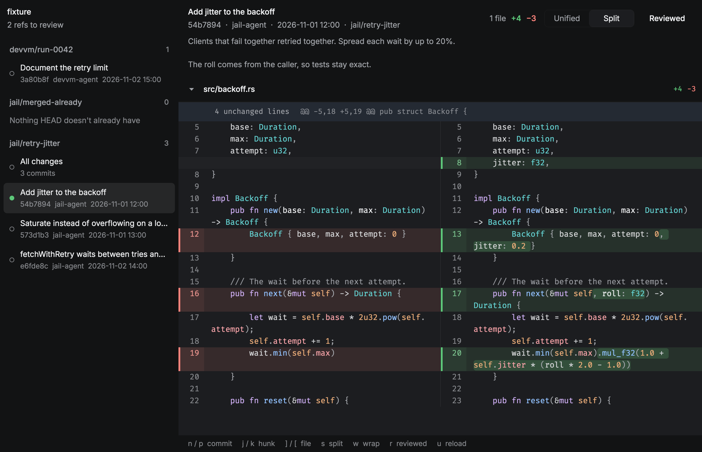

# refview

A native window for reading what a sandbox wrote before bringing it in. A trial of
[Rune](https://github.com/anomalyco/rune), pinned to one rev of its `dev` branch.



It lists the refs under `refs/jail/` and `refs/devvm/`, the commits each has that `HEAD`
lacks (oldest first), and shows the selected commit, or the whole ref, as a diff.

## Read it, never run it

refview runs five git commands, all of which only read: `for-each-ref`, `merge-base`, `log`,
`show` and `diff`. It never checks out, merges or builds a ref. The diff commands pass
`--no-ext-diff --no-textconv`, so a ref's `.gitattributes` can't make a review run a program.
Commit messages are drawn as text. See [src/git.rs](src/git.rs).

The list of commits you have marked reviewed lives outside the repository, in
`$XDG_STATE_HOME/refview/reviewed` (`~/.local/state/refview/reviewed`), one hash per line.
A rewritten ref has new hashes, so its commits show as unread again.

## Use

```sh
direnv allow            # or: nix develop
cargo run --release -- ~/path/to/repo
```

`refview [DIR] [--refs PATTERN]...` — DIR defaults to the current directory; `--refs`
replaces the default patterns (`refs/jail`, `refs/devvm`) and may repeat.

| Key | Does |
|---|---|
| `n` / `p` | next / previous commit |
| `j` / `k` | next / previous hunk |
| `]` / `[` | next / previous file |
| `s` | unified or split |
| `w` | wrap long lines |
| `r` | mark reviewed, or unmark (on "All changes": every commit of the ref) |
| `u` | read the refs again |

## Try it without a sandbox

```sh
scripts/fixture.sh /tmp/refview-fixture
cargo run -- /tmp/refview-fixture
```

## Checking it without a window

Rune apps render headless, so the UI can be checked from a script:

```sh
cargo build && scripts/headless/check.sh    # stills and element trees in out/
```

It replays [keys.json](scripts/headless/keys.json) and
[click.json](scripts/headless/click.json) against the fixture.

## Not done

- Patches are read on the UI thread. Fine for ordinary commits; a very large "All changes"
  will stall the window while git runs. `rune::Latest` is the way to move it off.
- No file tree beside the diff, no search, no comments.
- At most 500 commits are listed per ref.
